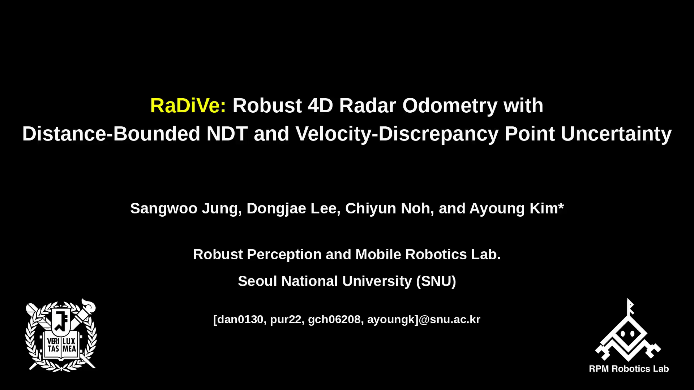

<h1 align="center">RaDiVe</h1>

<h3 align="center">
  Robust 4D Radar Odometry with<br>
  Distance-Bounded NDT and Velocity-Discrepancy Point Uncertainty
</h3>

<p align="center">
  <a href="https://sangwoojung98.github.io/">Sangwoo Jung</a> ·
  <a href="https://dongjae0107.github.io/">Dongjae Lee</a> ·
  <a href="https://chiyunnoh.github.io/">Chiyun Noh</a> ·
  <a href="https://ayoungk.github.io/">Ayoung Kim</a><sup>*</sup>
</p>

<p align="center">
  Robust Perception and Mobile Robotics Lab<br>
  Seoul National University
</p>

<p align="center">
  <a href="https://arxiv.org/abs/2607.28045"><b>Paper</b></a>
  &nbsp;·&nbsp;
  <a href="https://www.youtube.com/watch?v=Z-iFOsOrwhs"><b>Video</b></a>
  &nbsp;·&nbsp;
  <a href="#bibtex"><b>BibTeX</b></a>
</p>

> [!NOTE]
> Our work, **RaDiVe**, is accepted for **RA-L 2026**.
>
> **Code release:** TBD.

<p align="center">
  <a href="https://www.youtube.com/watch?v=Z-iFOsOrwhs">
    
  </a>
</p>

## Acknowledgement

This research received support from the National Research Foundation of Korea (NRF), funded by MSIT under grant RS-2024-00461409, and the Robotics and AI (RAI) Institute.

## BibTeX

```bibtex
@article{jung2026radive,
  title   = {RaDiVe: Robust 4D Radar Odometry with
             Distance-Bounded NDT and Velocity-Discrepancy Point Uncertainty},
  author  = {Jung, Sangwoo and Lee, Dongjae and Noh, Chiyun and Kim, Ayoung},
  journal = {arXiv preprint arXiv:2607.28045},
  year    = {2026},
  url     = {https://arxiv.org/abs/2607.28045},
}
```
